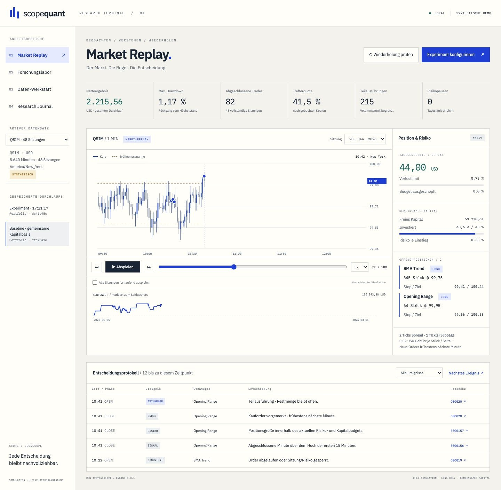
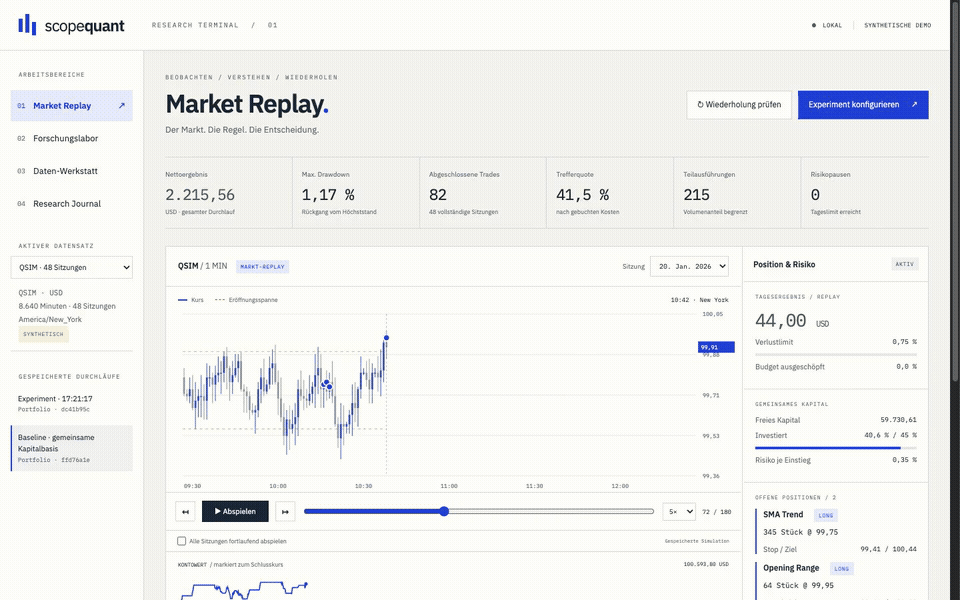
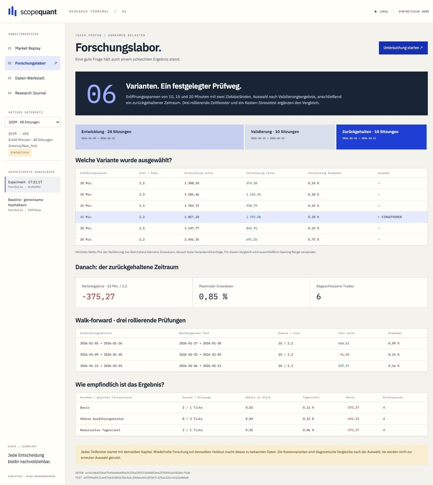

# Scope Quant

[English](README.md) · **Deutsch**

### Wie kam dieser Trade zustande?

Am Ende eines Backtests steht eine Zahl. Ich wollte bei jedem Trade anhalten können und sehen, wie sie zustande kommt: Welche Kursdaten waren bekannt, welche Regel hat ausgelöst und was wurde anschließend ausgeführt?

Dafür habe ich Scope Quant gebaut. Die lokale Anwendung verbindet den Import historischer CSV-Dateien mit einem Markt-Replay, zwei Referenzstrategien, einem gemeinsamen simulierten Konto und einem Forschungslabor. Jeder gespeicherte Durchlauf behält seine Datenversion, Einstellungen und Ereignisse.

*Das Instrument QSIM und alle gezeigten Kurse sind erfunden. Die Bilder stammen aus der laufenden Anwendung. Die Ergebnisse belegen keine Rentabilität am Markt.*

[Aufzeichnung als MP4 herunterladen](assets/quant-walkthrough.mp4?raw=true) · [Prüfergebnisse lesen](docs/VERIFICATION.md#deutsch) · [Zweiseitigen Berichtsauszug öffnen](assets/report-excerpt.pdf)

## Eine Entscheidung im Zusammenhang sehen

Das Replay läuft durch abgeschlossene Minuten. Blaue Markierungen zeigen Einstiege, bernsteinfarbene Markierungen Ausstiege. Das Protokoll folgt dem Chart. Ein Klick auf ein Ereignis öffnet die zugehörige Order, Stückzahl, den Preis und die Begründung.

Die Referenzstrategien Opening Range und SMA Trend verwenden dasselbe Konto. Einstiegsorders können teilweise ausgeführt werden, ablaufen oder abgelehnt werden. Nach dem Erreichen des Tagesverlustlimits bleiben neue Einstiege bis zur nächsten Sitzung gesperrt; bestehende Schutzorders bleiben aktiv.

## Annahmen prüfen

Das Forschungslabor vergleicht sechs Opening-Range-Varianten auf zeitlich getrennten Entwicklungs- und Validierungsdaten. Erst nach der Auswahl folgt der zurückgehaltene Zeitraum. Drei rollierende Prüfungen und veränderte Kostenannahmen ergänzen das Bild. Die Anwendung weist darauf hin, dass ein wiederholt betrachteter Testzeitraum bereits bekannte Daten enthält.

Im Journal lassen sich zwei Durchläufe mit derselben Datenversion direkt vergleichen. Ein lokales Qwen3-4B-Modell wählt passende berechnete Befunde und einen Folgeversuch aus. Zahlen und Erklärungstexte stammen aus geprüften Vorlagen. Das Modell kann weder die Simulation verändern noch Orders auslösen.

## Was funktioniert

| Bereich | Verhalten der Anwendung |
| --- | --- |
| Daten-Werkstatt | CSV-Prüfung, vollständige Sitzungen, Tickgenauigkeit, Dublettenschutz und Prüfsummen der Originaldateien |
| Simulation | Signale aus abgeschlossenen Minuten, spätere Einstiege, Teilausführungen, Kontoführung, Gebühren, Spread und Slippage |
| Replay | Synchroner Chart mit Positionen und Protokoll; Einzelschritt, Geschwindigkeitswahl und fortlaufende Sitzungen |
| Risiko | Gemeinsames Kapital, Positionsgrenzen, Tagespause und sichtbare Ablehnungsgründe |
| Forschung | Variantenvergleich, zurückgehaltene Daten, rollierende Zeitfenster, Belastungstests und gespeicherte Ergebnisse |
| Journal | Direkter Vergleich, begrenzte lokale Modellunterstützung sowie unveränderliche PDF- und CSV-Berichte |

[Orderdetails](assets/quant-event.jpg) · [Importprüfung](assets/quant-import.jpg) · [Research Journal](assets/quant-journal.jpg) · [Mobile Ansicht](assets/quant-mobile.jpg)

Die private Anwendung nutzt Python, SQLite, JavaScript, SVG-Charts, ReportLab und Ollama mit Qwen3. Ich habe sie mit Codex entwickelt. Dabei lag mein Schwerpunkt auf einer nachvollziehbaren Bedienung, klaren Simulationsregeln und überprüfbaren Berechnungen. [Entscheidungen und mein Beitrag →](docs/CASE_STUDY.de.md)

## Was die Ergebnisse abbilden

Die Simulation unterstützt ungehebelte Long-Positionen in einem Instrument und einer Währung. Grundlage sind vollständige Minutenkurse mit Volumen. Ein Anteil am gesamten Minutenvolumen begrenzt neue Einstiege als vereinfachte Liquiditätsannahme; Schutzorders werden vollständig ausgeführt. Berührt eine Kerze sowohl Stop als auch Ziel, wird der Stop zuerst gewertet. Kurssprünge und Kosten können das geplante Risikobudget überschreiten.

Brokeranbindung, Live-Kurse, Orderbuchtiefe, Leerverkäufe, Kapitalmaßnahmen und Futures-Kontraktwerte gehören nicht zu dieser Version. [Ausführungsannahmen im Detail →](docs/CASE_STUDY.de.md#annahmen-der-ausführung)

**Lokal geprüft am 20. Oktober 2026:** 52 automatisierte Tests bestanden. Dazu gehören unabhängig nachgerechnete Kontobewegungen, spätere Orderausführung, unveränderte frühere Entscheidungen bei veränderten Zukunftsdaten, Kurssprünge, Importintegrität und gespeicherte Berichte. Browser und lokales Modell wurden mit 48 erfundenen Sitzungen und 8.640 Minuten getestet. [Nachweise und Grenzen →](docs/VERIFICATION.md#deutsch)

**Dieses Repository enthält ausschließlich die Präsentation.** Quellcode, Datenbank, Modelle, importierte Tradingdaten, erzeugte Kursreihen und Trade-CSV-Dateien bleiben privat. Der Berichtsauszug zeigt ausgewählte synthetische Zusammenfassungen und Annahmen. Für die eigenen Portfolio-Inhalte wird keine Open-Source-Lizenz vergeben. [Rechte](RIGHTS.md) · [Hinweise zu Drittanbietern](THIRD_PARTY_NOTICES.md)
