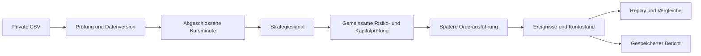
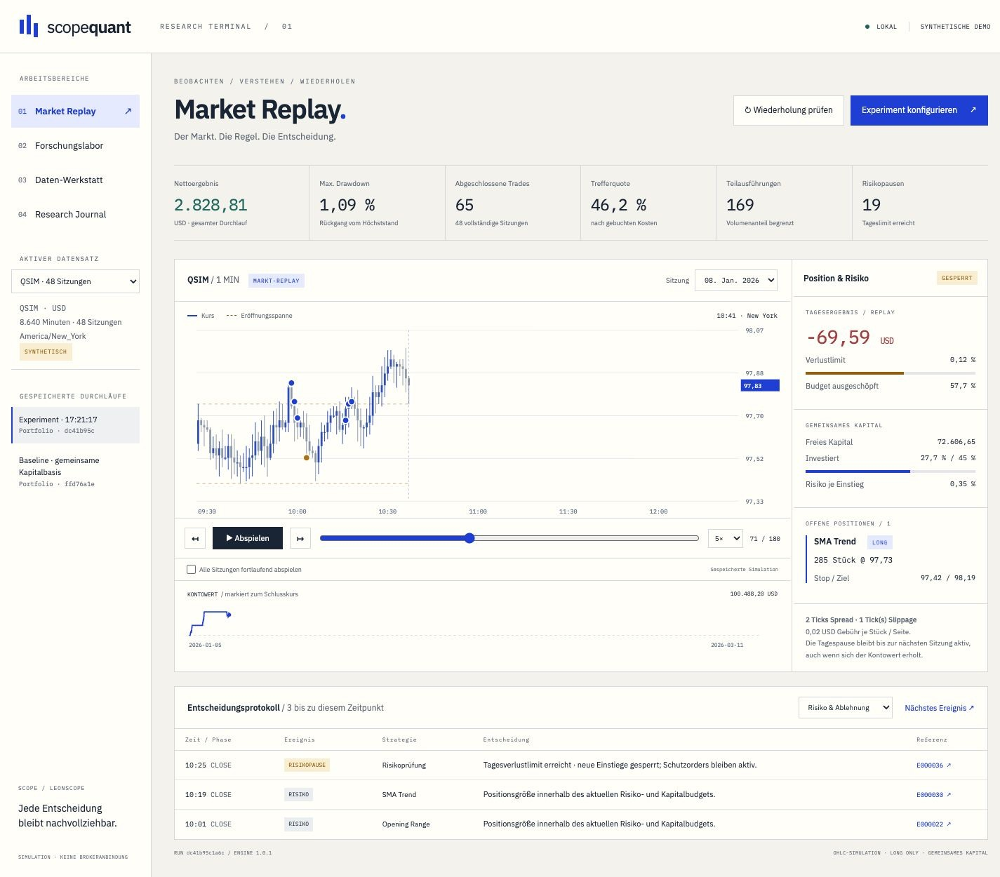

# Die Entscheidungen hinter Scope Quant

[English](CASE_STUDY.md) · [Projekt](../README.de.md)

Ich wollte eine Untersuchung so darstellen, dass man ihr folgen kann. Ein Chart wird für mich dann interessant, wenn sich seine Trades auf konkrete Regeln, bekannte Informationen und Kontobewegungen zurückführen lassen.

## Ein Replay aus gespeicherten Ereignissen

Die Simulation verarbeitet Minutenkurse der Reihe nach. Nach Abschluss einer Minute kann eine Strategie ein Signal erzeugen. Darauf folgen die Risikoprüfung und gegebenenfalls eine Order für eine spätere Minute. Beide Referenzstrategien verwenden dieselbe Kontoführung.

Die Oberfläche liest diese gespeicherte Ereignisfolge. Der Zeitregler verändert den sichtbaren Stand. Bei gleichen Daten und Einstellungen muss eine erneute Berechnung denselben Ergebnisfingerabdruck liefern.

## Ein klarer Vertrag für die Daten

Ein Import benötigt Zeitstempel mit UTC-Offset, zur Tickgröße passende Kurse, ganzzahliges Volumen und vollständige deklarierte Sitzungen. Doppelte, fehlende oder falsch sortierte Minuten sperren den Import. Originaldatei und vereinheitlichte Daten erhalten eigene Prüfsummen. Vor dem Speichern wird erneut geprüft; beim Laden wird die gespeicherte Integrität kontrolliert.

Das Demonstrationsinstrument QSIM enthält 48 lokal erzeugte Sitzungen mit Trends, Umkehrphasen und Seitwärtsbewegungen. Diese Daten dienen der Bedienung und den Integrationstests. Sie bilden keinen Börsenverlauf ab. Feiertage und Börsenkalender werden nicht automatisch geprüft.

## Annahmen der Ausführung

| Entscheidung | Regel dieser Version |
| --- | --- |
| Signalzeitpunkt | Die Strategie sieht nur abgeschlossene Minuten. |
| Einstieg | Frühestens zur nächsten Eröffnung; Restmengen können bis zu drei Minuten offen bleiben. |
| Liquidität | Ein festgelegter Anteil am gesamten Minutenvolumen begrenzt Einstiege. Das ist eine nachträgliche Näherung. |
| Kurse und Kosten | Feste Tickgröße, Spread, Slippage je Seite und Gebühren je Stück. |
| Kurssprünge | Bestehende Stops berücksichtigen die Eröffnung; neue Orders außerhalb ihres Stop-Ziel-Bereichs werden storniert. |
| Unbekannter Verlauf innerhalb der Minute | Berührter Stop hat Vorrang vor einem ebenfalls berührten Ziel. |
| Ausstiege | Schutzorders und Ausstiege zum Sitzungsende werden vollständig ausgeführt. |
| Tagesrisiko | Prüfung zur Eröffnung und zum Minutenschluss. Eine ausgelöste Pause bleibt bis zur nächsten Sitzung aktiv. |
| Kapital | Gemeinsames, ungehebeltes Long-only-Konto; der freie Geldbestand darf nicht negativ werden. |

Das Tageslimit sperrt neue Einstiege. Es garantiert keinen maximalen Verlust: Kurssprünge und Bewegungen innerhalb einer Minute können darüber hinausgehen. Tickdaten, Orderbuchposition, Netzwerklatenz, Markteinfluss und konkrete Auktionsabläufe sind nicht modelliert.

## Die Auswahl bleibt sichtbar

Sechs festgelegte Opening-Range-Varianten werden auf Entwicklungs- und Validierungszeiträumen untersucht. Die Auswahl erfolgt nach dem Nettoergebnis der Validierung, danach nach kleinerem Drawdown und einer festen Reihenfolge bei Gleichstand. Erst mit eingefrorenen Einstellungen folgt der zurückgehaltene Testzeitraum.

Drei rollierende Prüfungen wählen jeweils nur auf vorhergehenden Daten aus. Jedes Fenster startet mit demselben Kapital; die Einzelergebnisse werden nicht als gemeinsamer, verzinster Kontoverlauf ausgegeben. Kostenvergleiche folgen nach der Auswahl. Wer denselben Testzeitraum wiederholt betrachtet, arbeitet anschließend mit bekannten Daten. Dieser Hinweis bleibt in der Anwendung sichtbar.

## Die begrenzte Aufgabe des lokalen Modells

Qwen3 4B läuft auf demselben Mac. Das Modell wählt zwei vorhandene Befunde und eine Kategorie für einen Folgeversuch. Im Vergleichsmodus muss es berechnete Unterschiede zwischen Durchläufen mit gleichen Daten und Zeiträumen verwenden. Die Zahlen in den Antworten kommen aus festen Vorlagen.

Die Research-Frage beeinflusst diese Priorisierung. Das ist kein frei formulierender Marktanalyst, kein Prognosemodell und kein Nachweis von Ursachen. Eine abweichende Modellkennung oder eine ungültige Antwort führt zu keinem akzeptierten Ergebnis. Vorschläge bleiben als ungeprüft gekennzeichnet.

## Die Oberfläche

Warmes Weiß, Tintenblau und Ultramarin geben dem Arbeitsplatz eine eigene Richtung. IBM Plex Sans und IBM Plex Mono unterscheiden Erklärungen von Messwerten. Neben dem Chart stehen aktuelle Positionen und Risikowerte, darunter liegt das Protokoll. Der Risikobereich lässt sich in der Breite ändern. Auf schmalen Bildschirmen werden die Bereiche untereinander angeordnet.

## Mein Beitrag

Ich habe den Ablauf, die visuelle Richtung und die Trennung zwischen öffentlicher Präsentation und privater Umsetzung festgelegt. Die Anwendung entstand mit Codex. Für Kontoberechnung, Zeitlogik und Risikofälle wurden konkrete Prüfbeispiele verwendet.

Dabei mussten einige Details ausdrücklich entschieden werden: der Ablauf offener Restmengen, Kurssprünge außerhalb eines geplanten Einstiegs und eine nach Erholung weiterhin aktive Tagespause. Diese Regeln sind Teil der Fallstudie.

Scope Quant ist eine lokale Anwendung für eine Person. Große Produktivlast, Mehrbenutzerbetrieb, Broker-Ausführung und Rentabilität auf echten Marktdaten wurden nicht geprüft.
