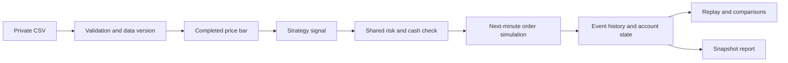

# The decisions behind Scope Quant

[Deutsch](CASE_STUDY.de.md) · [Project](../README.md)

I wanted the application to make an investigation easy to follow. A moving chart only becomes useful when its trades can be traced to rules, known information and account changes.

## A replay built from recorded events

The simulation processes price bars in sequence. A completed bar can create a signal, followed by a risk decision and an entry order for a later bar. Fills update the same cash ledger used by both reference strategies. Each event stores its bar, phase, strategy and relevant order or trade reference.

The interface reads that saved sequence. Scrubbing the replay changes the visible time; it does not invent a new trade path. A repeat run with identical data and settings must reproduce the full result fingerprint.

## Data has to pass a contract

Imports require explicit UTC offsets, valid tick-aligned OHLC prices, integer volume and complete declared sessions. Duplicate, missing and out-of-order minutes block the import. The original bytes and the canonical data have separate fingerprints. Commit validates the staged import again; loading a dataset checks its stored integrity.

The default instrument is called QSIM. Its 48 sessions are generated locally and contain trends, reversals and ranges. They are useful for demonstration and integration tests, but their prices do not come from an exchange. The application does not infer holidays or certify an exchange calendar.

## Execution assumptions

| Decision | Rule in this version |
| --- | --- |
| Signal timing | Only completed bars are available to the strategy. |
| Entry timing | The next bar open is the earliest entry; residual quantity can remain pending for three minutes. |
| Liquidity | A configured share of the whole minute's volume caps new entry quantity. This is an ex-post approximation. |
| Prices and costs | Fixed tick precision; spread, per-side slippage and per-unit fees. |
| Gaps | Existing stops see opening gaps; new orders outside their planned stop/target region are cancelled. |
| Unknown path inside a bar | Stop before target when both are touched. |
| Exits | Protective and final-session exits are assumed to fill fully. |
| Daily risk | Opening and closing equity are checked. A triggered pause stays active until the next session. |
| Capital | One shared, unleveraged, long-only cash ledger; no negative cash is allowed. |

The daily threshold blocks entries rather than guaranteeing a maximum loss. Open positions can lose more through price gaps or intrabar movement. Tick data, queue position, network latency, market impact and exchange-specific auction mechanics are outside the model.

## Research without hiding the selection step

Six fixed Opening Range variants are measured on development and validation periods. Selection uses validation net PnL, then lower drawdown and a fixed tie order. The chosen settings are frozen before the holdout is evaluated. A separate rolling-window view selects on preceding training periods.

Each window begins with the same capital. The displayed window results are separate experiments and are not added into a compounded account curve. Cost sensitivity is shown after selection. Repeating research on an already inspected holdout is explicitly described as using familiar data.

## A bounded role for the local model

Qwen3 4B runs on the same Mac. It selects two existing fact IDs and a follow-up category from a closed response schema. In comparison mode it must select calculated differences between runs with the same dataset and dates. Fixed templates provide all numeric statements.

The research question guides prioritization. This is not an unrestricted chat analyst, a predictive trading model or an explanation of causality. A changed local model digest or an invalid response blocks an accepted result. Drafts remain labeled as unreviewed suggestions.

## The interface

Warm white, ink blue and ultramarine give the workstation its own visual identity. IBM Plex Sans and IBM Plex Mono distinguish explanation from measurements. The main view puts the chart beside current risk and above the decision log. The risk pane is resizable; narrow screens stack the panels and retain dataset/run selection.

## My contribution and the development process

I defined the product workflow, the visual direction and the distinction between presentation material and private implementation. I developed the application with Codex, reviewed the visible behavior and used explicit tests for accounting, timing and risk cases.

The checks exposed details that needed clear rules: partial orders expiring, gaps moving beyond a planned entry, and a daily pause remaining latched after recovery. The final case study documents those rules rather than implying more market realism than was implemented.

The application is local, single-user software. Production load, multiuser isolation, broker execution and real-market profitability were not validated.
